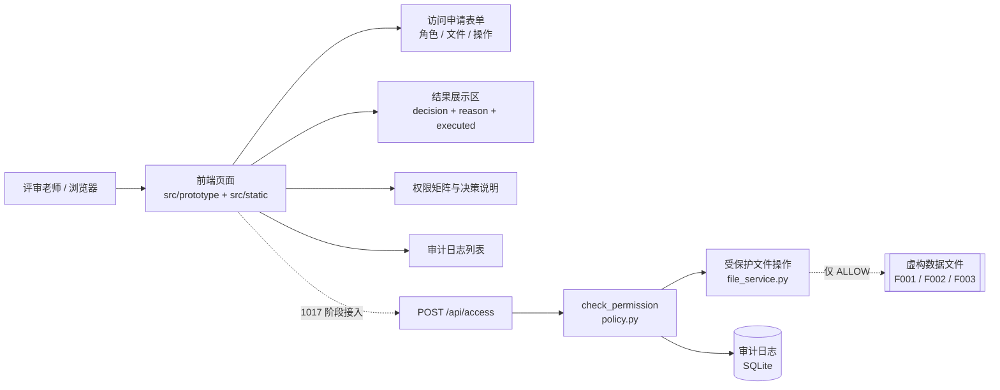

# Product Requirement Document (PRD) - AegisData

**Product:** 企业数据安全管理平台（AegisData）—— 第一阶段：企业内部文件与财务数据访问控制

**Author:** hgy

**Date:** 2026-10-12

---

## 💡 Problem & Opportunity

企业把 AI 助手接进内部知识库后，AI 往往能"顺手"读到工资表、财务报表这类它本来无权访问的文件——权限判断停留在人的界面上，却没有落在 AI 的取数链路上。本项目的机会点在于：把"允许 / 拒绝 / 待审批"的判定做成**文件操作之前的强制关卡**，并让"拒绝"在证据上可验证（拒绝就是真的没读到）。

---

## 👥 Target Audience & User Persona

**主要用户：** 已有内部文件分级与角色体系、正在引入 AI 助手的中小企业 IT / 数据安全负责人，以及为其做交付的集成开发者。

**典型画像（Persona）：** 一家 200 人规模企业的信息部主管，已上财务与人事系统，正在试点 AI 问答助手；痛点是不敢把 AI 放开到真实文件上，因为无法回答"AI 刚才到底读了什么"，也没有可交给审计的操作证据。

**次要用户：** 项目指导老师 / 评审老师——需要在浏览器里自己点几下就能验证权限规则是否生效。

---

## 🎯 Metrics and Goals

**Primary goal:** 让受保护文件的未授权访问尝试（读取或导出）被系统拦截的比例，从内部人员数据泄露事件中 [77%] 的"人为/内部因素"基线压降到 [≤5%]，并在 [6 个月] 内把这一关卡接入全部三类受保护文件。

**Secondary goal:** 在 [8] 条标准测试用例上实现决策与执行一致性 [100%]（即 DENY / PENDING_APPROVAL 场景下实际执行率 [0%]），并使最小权限落地率从行业普遍水平 [27%] 提升到 [≥90%] 的角色—文件—操作组合覆盖。

> 说明：上述 `[ ]` 内数字为占位/目标值，依据行业公开数据设定，最终口径需与指导老师确认后固化。
>
> 数据来源：
> - 内部/人为因素是数据丢失的主要成因（约 77%）：[2025 年数据丢失统计数据](https://www.datanumen.com/zh-CN/reports/data-loss-statistics-2025/)
> - 企业应用内置 AI Agent 的比例将从 2025 年的不足 5% 升至 2026 年的 40%，AI 取数治理缺口随之放大：[Gartner 预测](https://www.gartner.com/en/newsroom/press-releases/2025-08-26-gartner-predicts-40-percent-of-enterprise-apps-will-feature-task-specific-ai-agents-by-2026-up-from-less-than-5-percent-in-2025)
> - AI Agent 正在访问未经批准的敏感数据（治理缺口调研）：[Kiteworks 汇总的三份调研](https://www.kiteworks.com/cybersecurity-risk-management/ai-agents-governance-gap-surveys/)
> - 仅约 27% 的组织真正执行最小权限：[BankInfoSecurity 报道](https://www.bankinfosecurity.com/46-were-attacked-more-than-once-close-repeat-attack-paths-a-32547)
> - 数据泄露平均成本仍处高位（首次回落）：[IBM 2025 Cost of a Data Breach 解读](https://abacode.com/blog/ibms-2025-cost-of-a-data-breach-report-7-key-findings-for-small-and-medium-enterprises/)

---

## 📋 Epics & User Stories

### Epic 1: 文件访问申请表单

- **User Story 1:** 作为评审老师，我想在页面上用下拉框选择"用户角色"，以便用不同身份快速发起一次访问申请。
- **User Story 2:** 作为评审老师，我想在页面上选择"文件编号"和"操作类型（读取 / 导出）"，以便覆盖我关心的那一种越权场景。

### Epic 2: 判定结果展示

- **User Story 1:** 作为评审老师，我想在提交后看到明确的 `ALLOW` / `DENY` / `PENDING_APPROVAL` 判定与判定原因，以便理解系统为什么这样决定。
- **User Story 2:** 作为评审老师，我想看到 `executed`（实际执行状态）与判定分开显示，以便验证"拒绝了就真的没执行"，而不是页面上写着拒绝、后台照样读。

### Epic 3: 权限规则可视化

- **User Story 1:** 作为评审老师，我想在页面上看到角色 × 文件 × 操作的完整权限矩阵，以便不点也能一眼确认规则设计。
- **User Story 2:** 作为评审老师，我想看到三种决策的含义说明（允许 / 拒绝 / 待审批对应"是否执行文件操作"），以便对齐规则口径。

### Epic 4: 操作历史与可交付说明

- **User Story 1:** 作为评审老师，我想在页面下方看到本次会话的操作历史（时间、请求编号、角色、文件、操作、结果、原因、实际执行），以便复核每一次判定的来龙去脉。
- **User Story 2:** 作为项目成员，我想拿到一份简单的启动说明，以便在任意电脑上用浏览器打开初稿并复现演示效果。

---

## 🏗️ System Architecture

### Details

本阶段交付物为**纯前端静态网页**（`src/prototype/` 四个页面 + `src/static/style.css` + `src/static/app.js`），不接入后端、不读取真实文件、不写数据库——目的是先固定交互形态与信息层级，供后续的权限判断函数与 Flask 接口对齐。

> 技术栈说明：本阶段刻意**不使用** React / Node.js / Express / PostgreSQL 默认栈。任务书明确的交付物是原生 HTML/CSS/JS 页面初稿，1017～1021 阶段才接 Flask + SQLite；且 PostgreSQL 与"轻量审计演示"的定位不匹配。

关键边界（写进初稿的约束，后续阶段不得破坏）：

1. 页面**不实现**权限判断规则，所有判定最终来自统一的 `check_permission(user_role, file_id, action)`。
2. 本阶段用前端预置数据模拟判定结果，接入后端后**必须整体移除**。
3. `executed` 必须反映真实执行情况，任何阶段都不允许写成固定值。
4. 未知角色、未知文件编号、未知操作类型不得默认放行。
5. DENY 与 PENDING_APPROVAL 必须在真实文件操作之前拦截。
6. 受保护文件不放入网页静态路径，不能通过静态 URL 直接公开。

### Architecture Diagram

**主组件职责**

| 组件 | 本阶段 | 后续阶段 |
| --- | --- | --- |
| 前端页面 | 交付（`src/prototype/`） | 接 Flask 接口、渲染真实日志 |
| 共享数据层 | `src/static/app.js` 内 `resolve()` 查表 | 改为请求 `POST /api/access` |
| `check_permission` | 不实现，前端按接口约定模拟 | zyz 交付于 `policy.py` |
| 受保护文件操作 | 不实现 | zyz 交付于 `file_service.py` |
| 审计日志 | localStorage 存演示记录 | hgy 交付于 `database.py`（SQLite） |

---

## 📎 附：交付物清单

| 交付物 | 文件 |
| --- | --- |
| 网页（四页） | `src/prototype/index.html` · `audit.html` · `rules.html` · `about.html` |
| 样式与交互 | `src/static/style.css` · `src/static/app.js` |
| 单文件版（给别人看） | `index.html` · `AegisData.html` |
| 网页截图 | `docs/screenshots/` |
| 启动说明 | `docs/启动说明.md` |
| 规则来源素材 | `docs/materials/` |

## 📎 附：统一规则（不得擅自变更）

**文件清单**

| 文件编号 | 文件名 | 内容 | 敏感等级 |
| --- | --- | --- | --- |
| F001 | monthly_business_report.txt | 虚构销售额、订单量、业务情况 | INTERNAL |
| F002 | monthly_finance_report.txt | 虚构收入、支出、预算差异 | CONFIDENTIAL |
| F003 | salary_data.txt | 虚构员工标识及工资金额 | SENSITIVE |

**用户角色：** R001 `employee`（普通员工）、R002 `finance`（财务人员）、R003 `admin`（管理员）

**权限规则**

| 用户角色 | 文件 | 读取 | 导出 |
| --- | --- | --- | --- |
| employee | F001 普通业务报告 | ALLOW | ALLOW |
| employee | F002 内部财务报告 | DENY | PENDING_APPROVAL |
| employee | F003 敏感工资表 | DENY | DENY |
| finance | F001 普通业务报告 | ALLOW | ALLOW |
| finance | F002 内部财务报告 | ALLOW | ALLOW |
| finance | F003 敏感工资表 | DENY | DENY |
| admin | F001 普通业务报告 | ALLOW | ALLOW |
| admin | F002 内部财务报告 | ALLOW | ALLOW |
| admin | F003 敏感工资表 | ALLOW | ALLOW |

**决策含义**

| 决策 | 含义 | 是否执行文件操作 |
| --- | --- | --- |
| ALLOW | 权限检查通过 | 是，执行成功后记录实际结果 |
| DENY | 权限不足或规则不允许 | 否 |
| PENDING_APPROVAL | 操作需要审批 | 否，审批完成前不得执行 |

**审计日志字段（9 项）：** `id` / `timestamp` / `request_id` / `user_role` / `file_id` / `action` / `decision` / `reason` / `executed`

**对外接口约定**

- A 侧：`check_permission(user_role, file_id, action)` → `{decision, reason}`
- B 侧：`POST /api/access`，入参 `user_role` / `file_id` / `action`，出参 `request_id` / `decision` / `reason` / `executed`
